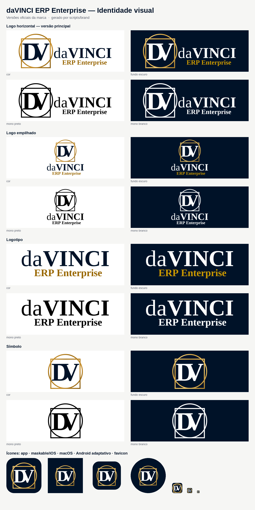

# daVINCI ERP Enterprise — Identidade visual



## Conceito

O monograma **DV** fica dentro da construção Vitruviana de Leonardo da Vinci: um **círculo** e um **quadrado** tangentes na base. É o mesmo símbolo de toda a família DaVinci (Qualidade, Finance…). O nome **daVINCI** em serifa clássica passa autoridade. A tagline **ERP Enterprise**, em ouro, identifica o produto.

## Estrutura

```text
brand/
├── README.md               ← este guia
├── preview.png             ← folha com todas as versões
├── source/
│   ├── original/           ← logos originais enviadas (raster, não editar)
│   └── fonts/              ← Liberation Serif (OFL), usada para converter o texto em curvas
├── svg/                    ← VETORES OFICIAIS (fonte da verdade)
│   ├── logo-horizontal/    ← versão principal
│   ├── logo-empilhado/
│   ├── logotipo/
│   ├── simbolo/
│   └── icone-app/          ← app, maskable, macOS, Android adaptativo (frente e monocromático)
├── png/                    ← exportações raster (geradas, não editar)
│   ├── logo-horizontal/  logo-empilhado/  logotipo/  simbolo/
│   ├── icone-app/          ← 1024/512/192 e maskable (PWA)
│   ├── social/             ← Open Graph, capa do LinkedIn, avatar
│   └── email/              ← assinatura de e-mail
├── plataformas/            ← peças prontas por plataforma (geradas, não editar)
│   ├── ios/                ← ícone 1024 (App Store) e 180/167/152/120 (iPhone e iPad)
│   ├── android/            ← adaptativo (frente, fundo, monocromático), legado mdpi–xxxhdpi, Play Store
│   ├── splash/             ← 2732×2732 claro e escuro (celular e tablet)
│   └── desktop/            ← windows/davinci.ico · macos/davinci.icns · linux/ (PNG e SVG)
└── favicon/                ← favicon.ico (16/32/48) + icon.svg
```

## Qual arquivo usar em cada plataforma

| Plataforma                                             | Onde                                          | Arquivos                                                                                                                                                                                     |
| ------------------------------------------------------ | --------------------------------------------- | -------------------------------------------------------------------------------------------------------------------------------------------------------------------------------------------- |
| **Web** (navegador, notebook, monitor)                 | `apps/web` (sincronizado pelo `brand:export`) | `src/app/favicon.ico`, `icon.svg`, `apple-icon.png`, `opengraph-image.png`; `public/brand/logo*.svg`, `simbolo*.svg`                                                                         |
| **PWA** (instalar pelo navegador, celular e tablet)    | `apps/web/src/app/manifest.ts`                | `public/brand/icon-192.png`, `icon-512.png`, `icon-maskable-512.png`                                                                                                                         |
| **iPhone e iPad** (app nativo, Capacitor/React Native) | `plataformas/ios/`                            | `davinci-ios-app-icon-1024.png` (App Store, opaco e sem cantos; o iOS aplica a máscara) + tamanhos 180/167/152/120                                                                           |
| **Android** (celular e tablet)                         | `plataformas/android/`                        | Ícone adaptativo: `…-frente-432.png` + `…-fundo-432.png` + `…-monocromatico-432.png` (ícone temático do Android 13+). Pastas `mipmap-*`: `legado/`. Play Store: `davinci-play-store-512.png` |
| **Splash** (abertura do app)                           | `plataformas/splash/`                         | `davinci-splash-2732.png` (claro) e `…-fundo-escuro-2732.png`. O sistema recorta o centro para cada tela                                                                                     |
| **Windows**                                            | `plataformas/desktop/windows/`                | `davinci.ico` (16, 24, 32, 48, 64, 128, 256)                                                                                                                                                 |
| **macOS**                                              | `plataformas/desktop/macos/`                  | `davinci.icns` (16–1024, @1x e @2x, na grade do Big Sur) e `davinci-macos-1024.png`                                                                                                          |
| **Linux**                                              | `plataformas/desktop/linux/`                  | `davinci.svg` + PNG 512/256/128                                                                                                                                                              |
| **Redes sociais e e-mail**                             | `png/social/`, `png/email/`                   | Open Graph 1200×630, capa do LinkedIn, avatar 400, assinatura de e-mail 600                                                                                                                  |

## Versões da logo

| Versão              | Quando usar                                                             |
| ------------------- | ----------------------------------------------------------------------- |
| **Logo horizontal** | **Padrão.** Cabeçalho do sistema, site, documentos, relatórios, e-mails |
| **Logo empilhado**  | Espaços quadrados ou verticais: tela de login, splash, crachás          |
| **Logotipo**        | Quando o símbolo já aparece por perto, ou não há altura para ele        |
| **Símbolo**         | Favicon, avatar, marca d'água, menu recolhido, espaços pequenos         |
| **Ícone de app**    | PWA, lojas, atalhos e desktop (símbolo sobre o marinho `#001228`)       |

Cada versão tem quatro variantes de cor:

| Sufixo          | Fundo         | Observação                                     |
| --------------- | ------------- | ---------------------------------------------- |
| _(sem sufixo)_  | Claro         | Versão colorida principal                      |
| `-fundo-escuro` | Escuro        | Texto em branco, dourado e tagline mais claros |
| `-mono-preto`   | Claro         | Impressão em 1 cor, carimbo, gravação          |
| `-mono-branco`  | Escuro / foto | Sobre imagens ou fundos coloridos              |

Os PNGs vêm com fundo transparente, em várias larguras (sufixos `-512`, `-1024`, `-2048`…). Use SVG sempre que puder; PNG só onde SVG não é aceito.

## Cores

| Nome     | HEX                                           | Uso                                                  |
| -------- | --------------------------------------------- | ---------------------------------------------------- |
| Marinho  | `#001228`                                     | Monograma, "daVINCI", fundo escuro, fundo dos ícones |
| Ouro     | `#A06D10` (claro `#E3A945`, escuro `#7A520A`) | Moldura Vitruviana                                   |
| Ouro ERP | `#986600` (no fundo escuro: `#CB9800`)        | Tagline ERP Enterprise                               |

## Regras de uso

- **Área de proteção:** deixe ao redor da marca um espaço livre de pelo menos a altura da letra **V** do monograma.
- **Tamanho mínimo:** logo horizontal com 160 px (ou 40 mm) de largura, para a tagline continuar legível. Símbolo com 24 px. Abaixo disso, use o `favicon/icon.svg`, que tem traço reforçado.
- **Não faça:** distorcer, girar, trocar as cores, separar o DV da moldura, aplicar sombras ou contornos, ou usar a versão colorida sobre fundo sem contraste (nesse caso, use a mono).

## Regenerar

```bash
pip install -r scripts/brand/requirements.txt   # fonttools + Pillow (ImageMagick 7 também é necessário)
pnpm brand:svg      # reconstrói os SVGs (svg/, favicon/icon.svg)
pnpm brand:export   # exporta PNGs, plataformas, favicon, peças sociais, preview e sincroniza o apps/web
```

> **Sobre os vetores:** a logo original existe só em raster. Os SVGs foram reconstruídos a partir das medidas dela, com o texto convertido em curvas e no mesmo espaço de coordenadas dos demais produtos DaVinci. Por isso o símbolo e o nome são idênticos em toda a família. A versão vetorial não reproduz a sombra projetada do raster, seguindo a regra "não aplicar sombras". Se o designer entregar o vetor original (.ai, .svg ou .pdf), guarde-o em `source/original/` e substitua os SVGs.
