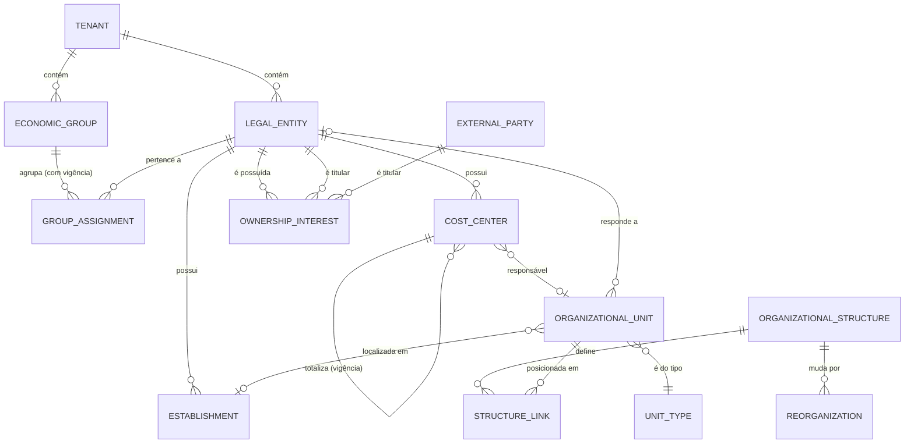

# Organization Management — Modelo de domínio

> Estado: **proposta para aprovação** (Fase 2, etapa 1). Nada implementado. Decisões: ADR-0017 a ADR-0022.

## 1. Linguagem ubíqua

O termo "organização" já tem dois significados na plataforma. Para não haver ambiguidade, o glossário abaixo é obrigatório no código, na API e na documentação.

| Termo                                                    | Significado                                                                                                                                            | Contexto dono           |
| -------------------------------------------------------- | ------------------------------------------------------------------------------------------------------------------------------------------------------ | ----------------------- |
| **Tenant**                                               | Cliente contratante: unidade de contrato, isolamento, célula e residência de dados                                                                     | Tenant Registry         |
| **Organização do Keycloak**                              | Projeção técnica do tenant no IdP (claim `organization` do token)                                                                                      | Identity                |
| **Grupo econômico** (`EconomicGroup`)                    | Conjunto de entidades jurídicas sob controle comum (holding e controladas) ou que o cliente quer gerir como grupo                                      | Organization Management |
| **Entidade jurídica** (`LegalEntity`)                    | Pessoa jurídica com personalidade própria num país: tem razão social, forma jurídica, registros fiscais, moeda funcional e calendário fiscal           | Organization Management |
| **Estabelecimento** (`Establishment`)                    | Local físico ou fiscal de uma entidade jurídica: matriz, filial, fábrica, loja, depósito. No Brasil, cada filial com CNPJ próprio é um estabelecimento | Organization Management |
| **Unidade organizacional** (`OrganizationalUnit`)        | Unidade de gestão: unidade de negócio, divisão, diretoria, departamento, unidade operacional, equipe                                                   | Organization Management |
| **Estrutura organizacional** (`OrganizationalStructure`) | Uma árvore nomeada e com vigência de unidades organizacionais (ex.: estrutura gerencial, funcional, regional)                                          | Organization Management |
| **Reorganização** (`Reorganization`)                     | Conjunto de mudanças numa estrutura, aprovado e aplicado de uma vez numa data de vigência                                                              | Organization Management |
| **Centro de custo** (`CostCenter`)                       | Objeto de acumulação de custos de uma entidade jurídica, com hierarquia própria de totalização                                                         | Organization Management |
| **Participação societária** (`OwnershipInterest`)        | Percentual de capital e de voto que um titular detém numa entidade jurídica, com vigência                                                              | Organization Management |
| **Titular externo** (`ExternalParty`)                    | Sócio que não é entidade jurídica do tenant: empresa de fora do grupo, fundo, pessoa física                                                            | Organization Management |

"Organization" sozinho só aparece como nome do contexto (Organization Management) e do serviço (`organization`). Nenhuma entidade de domínio se chama apenas "Organization".

## 2. Avaliação dos conceitos pedidos (DDD)

| Conceito                 | Classificação                                                                          | Decisão e motivo                                                                                                                                                       |
| ------------------------ | -------------------------------------------------------------------------------------- | ---------------------------------------------------------------------------------------------------------------------------------------------------------------------- |
| Economic Group           | **Agregado**                                                                           | Ciclo de vida próprio. A pertença das entidades é registrada na entidade jurídica, com vigência (entidades mudam de grupo em fusões e aquisições)                      |
| Organization             | **Não vira entidade**                                                                  | Redundante com grupo econômico (a "empresa" do cliente) e conflita com a organização do Keycloak. Um cliente de empresa única tem um grupo com uma entidade (ADR-0017) |
| Legal Entity             | **Agregado**                                                                           | Raiz da estrutura legal e fiscal; referenciada por quase todos os outros contextos (Finance, Accounting, Tax, HR)                                                      |
| Business Unit            | **Tipo de unidade organizacional**                                                     | Mesma natureza de departamento e unidade operacional (nó de gestão); muda só o tipo e as regras de aninhamento                                                         |
| Branch                   | **Agregado `Establishment`**                                                           | Filial é estabelecimento de uma entidade jurídica, não unidade de gestão. Separado da entidade porque redes varejistas têm milhares de lojas (agregado grande demais)  |
| Operational Unit         | **Tipo de unidade organizacional**                                                     | Idem Business Unit                                                                                                                                                     |
| Department               | **Tipo de unidade organizacional**                                                     | Idem                                                                                                                                                                   |
| Cost Center              | **Agregado**                                                                           | Pertence a uma entidade jurídica; ciclo de vida e hierarquia de totalização próprios, independentes da estrutura gerencial                                             |
| Organizational Structure | **Agregado** (`OrganizationalStructure`) + **relação com vigência** (aresta pai→filho) | Permite várias visões (gerencial, funcional, regional) sem uma hierarquia genérica única                                                                               |
| Ownership Relationship   | **Agregado** (`OwnershipInterest`)                                                     | Relação entre duas partes, com percentuais e vigência; validada por um serviço de domínio (soma ≤ 100%, sem ciclo)                                                     |

### Conceitos adicionais necessários

| Conceito          | Classificação                   | Por quê                                                                                                                                    |
| ----------------- | ------------------------------- | ------------------------------------------------------------------------------------------------------------------------------------------ |
| `UnitType`        | Entidade de catálogo por tenant | Cada cliente nomeia seus níveis (diretoria, gerência, célula) e define quais tipos podem ser pais de quais                                 |
| `Reorganization`  | Agregado                        | Mudanças grandes (fusão de áreas, troca de centenas de vínculos) precisam ser preparadas, aprovadas e aplicadas de forma atômica numa data |
| `ExternalParty`   | Agregado pequeno                | Sócios fora do tenant; pode conter dado pessoal (pessoa física)                                                                            |
| `TaxIdentifier`   | Objeto de valor                 | Identificador fiscal por país e esquema (CNPJ, EIN, NIF, VAT), com validação extensível                                                    |
| `EffectivePeriod` | Objeto de valor                 | Vigência `[validFrom, validTo)`, base de todo o histórico                                                                                  |
| `PostalAddress`   | Objeto de valor                 | Endereço internacional (campos variam por país)                                                                                            |
| Tenant (projeção) | Projeção local                  | Estado do tenant recebido por eventos; tenant suspenso fica somente leitura                                                                |

## 3. Agregados

### 3.1 `EconomicGroup`

| Campo               | Tipo                      | Regra                                    |
| ------------------- | ------------------------- | ---------------------------------------- |
| `id`                | UUID                      |                                          |
| `code`              | `BusinessCode`            | Único por tenant                         |
| `name`              | texto                     | 1–200 caracteres                         |
| `referenceCurrency` | `CurrencyCode` (ISO 4217) | Moeda de consolidação                    |
| `referenceTimezone` | `ZoneId` (IANA)           | Interpreta vigências de alcance do grupo |
| `status`            | `ACTIVE`, `CLOSED`        |                                          |

**Invariantes:** só pode ser encerrado sem entidades jurídicas vinculadas na data de encerramento.

### 3.2 `LegalEntity`

| Campo                        | Tipo                                              | Regra                                                                      |
| ---------------------------- | ------------------------------------------------- | -------------------------------------------------------------------------- |
| `id`, `code`                 | UUID, `BusinessCode`                              | Código único por tenant                                                    |
| `legalName`, `tradeName`     | texto                                             | Razão social não é traduzida                                               |
| `country`, `subdivision`     | ISO 3166-1 alfa-2, ISO 3166-2                     | Jurisdição de constituição                                                 |
| `legalForm`                  | `LegalForm(country, code)`                        | Catálogo por país (ex.: BR `LTDA`, `SA`; US `LLC`)                         |
| `taxIdentifiers`             | lista de `TaxIdentifier` com vigência             | Pelo menos um principal ativo para entidade `ACTIVE`, quando o país exigir |
| `functionalCurrency`         | ISO 4217                                          | Moeda da contabilidade da entidade                                         |
| `timezone`                   | IANA                                              | Interpreta as vigências da entidade e de seus estabelecimentos             |
| `defaultLocale`              | BCP 47                                            | Idioma de documentos                                                       |
| `fiscalYearStartMonth`       | 1–12                                              | Calendário fiscal                                                          |
| `registeredAddress`          | `PostalAddress`                                   | Sede legal                                                                 |
| `groupAssignments`           | histórico de `(economicGroupId, EffectivePeriod)` | No máximo um grupo por data; sem sobreposição                              |
| `incorporatedOn`, `closedOn` | data                                              |                                                                            |
| `status`                     | máquina de estados abaixo                         |                                                                            |

```
PLANNED ──ativar──▶ ACTIVE ⇄ SUSPENDED
   │                  │          │
   └──descartar       └─encerrar─┴──▶ CLOSED (terminal)
```

**Invariantes**

- Identificador fiscal único por tenant e esquema enquanto vigente; o mesmo CNPJ pode existir em tenants diferentes (escritório contábil).
- O identificador fiscal é validado pela regra do seu esquema (ex.: dígitos verificadores do CNPJ).
- Encerrar exige que, na data, não haja estabelecimento, unidade ou centro de custo ativo vinculado.
- `PLANNED` pode ser descartado (exclusão física) somente se nunca foi referenciado.

### 3.3 `Establishment`

Campos: `id`, `legalEntityId`, `code`, `name`, `type` (`HEADQUARTERS`, `BRANCH`, `PLANT`, `STORE`, `WAREHOUSE`, `OFFICE`, `OTHER`), `address`, `taxIdentifiers`, `timezone`, `status` (`ACTIVE`, `SUSPENDED`, `CLOSED`), `openedOn`, `closedOn`.

**Invariantes**

- Pertence a exatamente uma entidade jurídica do mesmo tenant, imutável (trocar de entidade = encerrar e abrir outro).
- No máximo um `HEADQUARTERS` não encerrado por entidade jurídica.
- Só é aberto ou reativado com a entidade jurídica `ACTIVE`. Suspender a entidade não suspende os estabelecimentos (a empresa inativa mantém os registros); encerrar a entidade exige todos os estabelecimentos encerrados.
- Fica no país da entidade (estabelecimento no exterior fica para uma etapa futura).
- O identificador fiscal do estabelecimento é coerente com o da entidade quando o esquema exigir (ex.: mesma raiz de CNPJ). Regra plugável por país.

### 3.4 `OrganizationalUnit`

Campos: `id`, `code`, `name` (`LocalizedText`: nome por idioma, com padrão), `unitTypeId`, `legalEntityId` (opcional: entidade que emprega ou responde pela unidade), `establishmentId` (opcional: onde fica), `status` (`ACTIVE`, `INACTIVE`, `CLOSED`), `validFrom`, `validTo`.

A unidade **não guarda o pai**: a posição dela está em cada estrutura (3.5). Assim a mesma unidade aparece na estrutura gerencial e na funcional com pais diferentes.

**Invariantes**

- Se tiver `establishmentId`, o estabelecimento pertence à `legalEntityId` informada.
- Encerrar exige não ter filhos ativos, na data, em nenhuma estrutura.

### 3.5 `OrganizationalStructure` e vínculos com vigência

Uma estrutura tem `id`, `code`, `name`, `purpose` (`MANAGEMENT`, `FUNCTIONAL`, `GEOGRAPHIC`, `CUSTOM`), uma ou mais raízes, e **vínculos** `(unitId, parentUnitId | raiz, EffectivePeriod)`.

**Invariantes (por estrutura e por data)**

1. Cada unidade tem no máximo um pai vigente (sem sobreposição de vigência).
2. **Sem ciclos:** o novo pai não pode estar na subárvore da unidade, em nenhuma data do período do vínculo.
3. Regras de aninhamento do `UnitType` (ex.: departamento não pode ser pai de diretoria), quando configuradas.
4. Pai e filho pertencem ao mesmo tenant (garantido também pelo banco).

Mover uma unidade = encerrar o vínculo atual na data D e abrir outro a partir de D. O histórico nunca é sobrescrito.

### 3.6 `Reorganization`

```
DRAFT ──submeter──▶ PENDING_APPROVAL ──aprovar──▶ SCHEDULED ──(data chega)──▶ APPLIED
  │                        │                           │
  └──cancelar              └──rejeitar ──▶ DRAFT       └──cancelar ──▶ CANCELLED
```

Contém passos ordenados: `CREATE_UNIT`, `MOVE_UNIT`, `RENAME_UNIT`, `CLOSE_UNIT`, `REASSIGN_COST_CENTER`, todos numa mesma estrutura e numa mesma data de vigência.

**Invariantes**

- Quem aprova não é quem submeteu (segregação de funções).
- Ao aplicar, todos os passos são validados juntos contra o estado na data (sem ciclos, sem unidade fechada com filhos) e aplicados numa única transação: ou tudo, ou nada.
- Uma reorganização aplicada é imutável; desfazer é outra reorganização.

### 3.7 `CostCenter`

Campos: `id`, `legalEntityId`, `code` (único por entidade), `name`, `kind` (`POSTABLE` recebe lançamentos; `GROUP` só totaliza), `category` (`PRODUCTION`, `ADMINISTRATIVE`, `SALES`, `RESEARCH`, `OTHER`), `responsibleUnitId` (opcional), `status` (`ACTIVE`, `BLOCKED`, `CLOSED`), `validFrom`, `validTo`, e vínculo de hierarquia com vigência `(parentCostCenterId, EffectivePeriod)`.

**Invariantes**

- Pai é um centro `GROUP` da mesma entidade jurídica; sem ciclos.
- `BLOCKED` não recebe novos lançamentos (regra aplicada pelos contextos financeiros, que consomem o evento).
- Encerrar exige não ter filhos ativos na data.

### 3.8 `OwnershipInterest`

Campos: `id`, `ownedLegalEntityId`, titular (`ownerLegalEntityId` **ou** `ownerExternalPartyId`, exatamente um), `capitalPercentage` e `votingPercentage` (`Percentage`, 0–100 com 4 casas), `shareClass` (opcional), `EffectivePeriod`.

**Invariantes (por entidade possuída e por data)**

1. Soma das participações de capital ≤ 100%; idem para voto.
2. Uma entidade não é titular de si mesma.
3. **Sem ciclo de participação** entre entidades do tenant nesta fase. Participações cruzadas existem na prática; o suporte fica para depois, junto com o cálculo de consolidação.
4. Titular e possuída pertencem ao mesmo tenant; titular externo também é do tenant.

**Derivados** (calculados, não gravados): participação efetiva indireta (produto ao longo dos caminhos, somado entre caminhos), controlador final, cadeia de controle (voto > 50% ou controle declarado).

## 4. Objetos de valor

| Objeto                           | Regra                                                                                                                                                                       |
| -------------------------------- | --------------------------------------------------------------------------------------------------------------------------------------------------------------------------- |
| `BusinessCode`                   | 1–40 caracteres, `[A-Z0-9._-]`, maiúsculo; único no escopo definido pelo agregado                                                                                           |
| `CountryCode`, `SubdivisionCode` | ISO 3166-1 alfa-2 / ISO 3166-2, validados contra lista                                                                                                                      |
| `CurrencyCode`                   | ISO 4217 (`java.util.Currency`)                                                                                                                                             |
| `LocaleTag`                      | BCP 47 (`pt-BR`, `en-US`)                                                                                                                                                   |
| `Timezone`                       | IANA (`java.time.ZoneId`), nunca deslocamento fixo                                                                                                                          |
| `EffectivePeriod`                | `validFrom` (data, inclusive) e `validTo` (data, exclusiva, opcional = sem fim); `validTo > validFrom`                                                                      |
| `Percentage`                     | `BigDecimal` 0–100, escala 4; nunca ponto flutuante                                                                                                                         |
| `TaxIdentifier`                  | `(scheme, value)`: `scheme` de catálogo (`BR_CNPJ`, `BR_CPF`, `US_EIN`, `PT_NIF`, `EU_VAT`…), valor normalizado, validação pela regra do esquema                            |
| `PostalAddress`                  | `country` obrigatório + campos no padrão internacional (linhas de endereço, localidade, região administrativa, código postal); obrigatoriedade e formato definidos por país |
| `LocalizedText`                  | Mapa idioma → texto, com idioma padrão obrigatório                                                                                                                          |
| `LegalForm`                      | `(country, code)` de catálogo                                                                                                                                               |

## 5. Serviços de domínio

| Serviço                        | Responsabilidade                                                                              |
| ------------------------------ | --------------------------------------------------------------------------------------------- |
| `StructureHierarchyPolicy`     | Valida movimentos: ciclo, sobreposição, regras de aninhamento, status das unidades            |
| `OwnershipPolicy`              | Soma ≤ 100%, ausência de ciclo, titular ≠ possuída                                            |
| `EffectiveOwnershipCalculator` | Participação indireta e cadeia de controle numa data                                          |
| `ReorganizationExecutor`       | Valida e aplica os passos de uma reorganização de forma atômica                               |
| `TaxIdentifierValidators`      | Registro de validadores por esquema (extensão por país, ADR-0022)                             |
| `ClosurePolicy`                | Verifica dependências antes de encerrar entidade, estabelecimento, unidade ou centro de custo |

## 6. Eventos de domínio

Cada mudança relevante gera um evento de integração (catálogo completo em ORGANIZATION_EVENTS.md): grupo, entidade jurídica, estabelecimento, unidade, estrutura (vínculos), reorganização, centro de custo e participação societária. Todos carregam o estado completo do agregado e a vigência.

## 7. Diagrama de relacionamentos



Quatro relações hierárquicas **distintas**, cada uma com suas regras:

| Relação                        | Forma                                   | Regras próprias                               |
| ------------------------------ | --------------------------------------- | --------------------------------------------- |
| Entidade → grupo econômico     | Pertença com vigência                   | Um grupo por data                             |
| Participação societária        | Grafo dirigido acíclico com percentuais | Soma ≤ 100%; voto e capital separados         |
| Estrutura organizacional       | Árvore por estrutura, com vigência      | Sem ciclos; regras de tipo; várias estruturas |
| Hierarquia de centros de custo | Árvore por entidade, com vigência       | Pai é `GROUP` da mesma entidade               |

Estabelecimento → entidade é pertença simples (chave estrangeira imutável), não hierarquia.

## 8. Exemplo

Grupo multinacional num tenant da região `br-1`:

```
Grupo "Acme Global" (BRL)
├── Acme Participações S.A. (BR, holding)        ── possui 100% ──▶ Acme Indústria Ltda (BR)
│                                                ── possui  60% ──▶ Acme Argentina S.A. (AR)
│                                                                       └── 40% de sócio externo
├── Acme Indústria Ltda: estabelecimentos Matriz SP, Fábrica Joinville, CD Recife
└── Estrutura gerencial (vigente em 2026-11-01):
    Presidência
    ├── Diretoria Industrial ── Fábrica Joinville (unidade operacional)
    └── Diretoria Comercial ─── Vendas Sul, Vendas Nordeste
```

Entidades jurídicas que precisem residir em outra jurisdição (ex.: UE) ficam num tenant da respectiva região. Ver ADR-0017.
